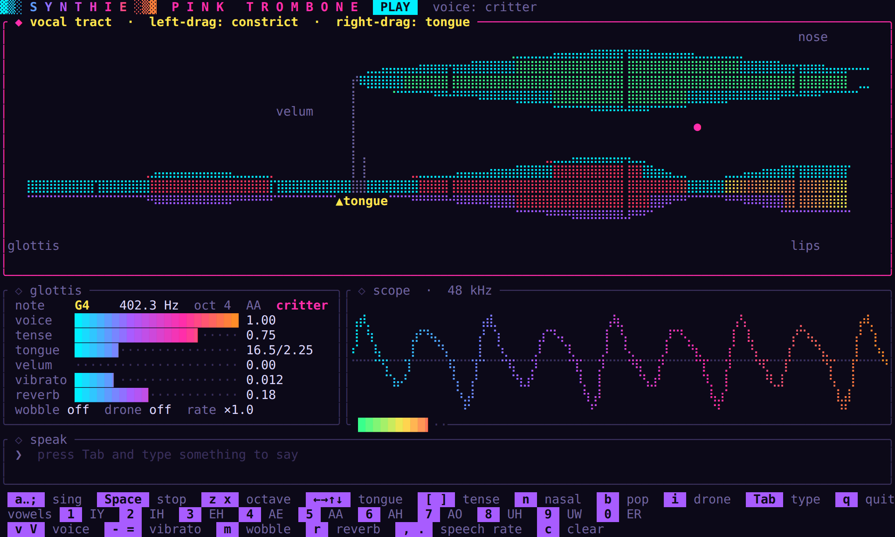
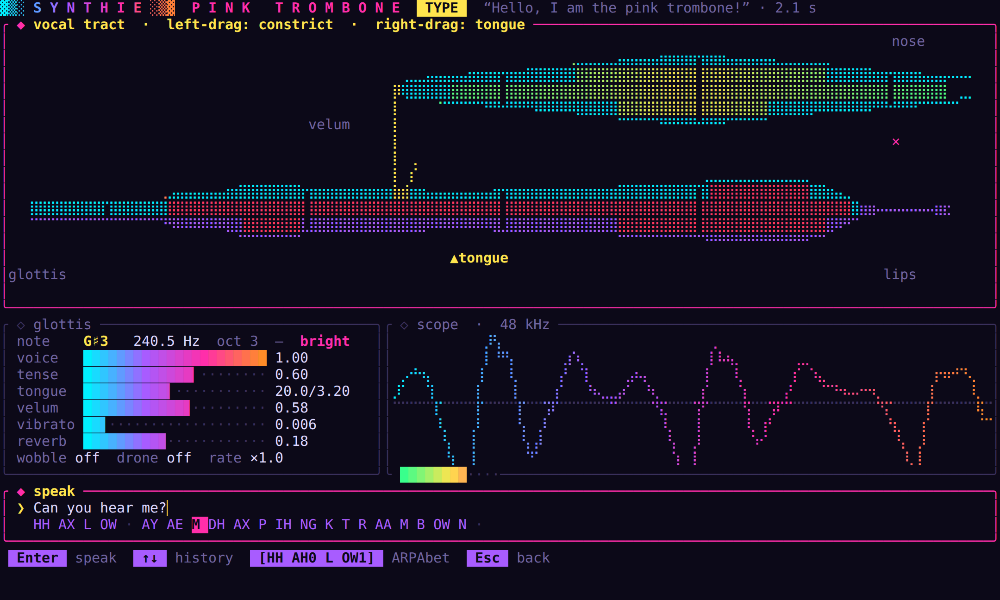

# synthie-trombone

This is [Pink Trombone](https://dood.al/pinktrombone/), Neil Thapen's
physical model of the human voice, rebuilt in Rust: a glottal source pushes
air through a 44-cell waveguide of the vocal tract, you squeeze the tract
somewhere, and out comes something between a vowel and a very confused
trombone. You can play it in your terminal, have it read your text aloud, or
give the characters in your game a voice.





## Trying it out

You'll need a Rust toolchain (1.88 or newer for the library) and, on Linux,
the ALSA headers for audio output (`libasound2-dev` on Debian and Ubuntu).
The project uses [go-task](https://taskfile.dev/); `task` on its own lists
everything it can do.

```sh
task run                                   # start the terminal app
task install                               # install it as ~/.cargo/bin/synthie-trombone
task say -- --voice bright "Hello there!"  # speak a line into say.wav
task voices -- "Welcome, traveller!"       # the same line in every voice, in voices/*.wav
```

Without `task`, run `cargo run --release -p synthie-trombone-cli` for the app
and `cargo run --release -p synthie-trombone --example say -- "…"` for a WAV
file. Stick to release builds: the tract model takes 96,000 steps per second
of audio, and a debug build can't keep up with the sound card.

## Playing the terminal app

The app starts in play mode, with the piano on your home row. Hold a key to
sing, change the vowel with the number keys, and drag across the tract with
the mouse to shape consonants the way you would with a finger in the
original.

| Key | Action |
|---|---|
| `a w s e d f t g y h u j k o l p ;` | sing, piano layout; `z` / `x` change the octave |
| `Space` or `Esc` | stop singing (and speaking) |
| `1` … `0` | vowels IY IH EH AE AA AH AO UH UW ER |
| arrow keys | move the tongue body |
| left-drag on the tract | constrict it |
| right-drag on the tract | move the tongue |
| `v` / `V` | next / previous voice |
| `n`, `b`, `i` | nasal (velum), lip pop, drone |
| `[` `]`, `-` `=` | tenseness, vibrato |
| `m`, `r`, `c` | pitch wobble, reverb amount, clear constrictions |
| `Tab` | type a line; `Enter` speaks it at the current note's pitch |
| `,` `.` | speech rate |
| `q` | quit |

Notes stop when you let go of the key in terminals that report key releases
(kitty, WezTerm, foot, Ghostty). In other terminals a note holds until you
press `Space`.

## Voices

You pick a voice with `v` in the app, `--voice` on the command line, or a
`Preset` in code:

| Preset | Character |
|---|---|
| `deep` | 105 Hz, the model's native tract |
| `bright` | 210 Hz, tract 0.86, livelier intonation |
| `child` | 290 Hz, tract 0.72 |
| `elder` | breathy and slow, with a tremor and a shaky pitch |
| `giant` | 62 Hz, tract 1.4, slow |
| `critter` | 360 Hz, tract 0.6, fast, nasal and very excitable |
| `robot` | monotone, no jitter, pressed |
| `whisper` | breath only, no voicing |

Pitch and vocal tract length vary independently from person to person:
raising only the pitch sounds like the same speaker reaching higher, while a
shorter tract shifts every resonance and sounds like a smaller speaker. The
tract values above are relative to the model's native tract of about 17 cm.
The presets combine both with tenseness, jitter, vibrato, nasality, speaking
rate and how much the intonation moves, and all of these are public fields
of `VoiceSettings`, so your own voice starts from a preset and changes what
you like. With the `serde` feature, the settings can live in your game's
data files.

## Making your game talk

Add the library (`synthie-trombone`, in `crates/synthie-trombone`) to your
project, tune a `Talker` once, and turn each line into mono `f32` samples
for whatever plays your audio:

```rust
use synthie_trombone::{Preset, Talker, VoiceSettings, normalize};

let mut shopkeeper = Talker::new(44_100.0, Preset::Elder);
let mut line = shopkeeper.bake("Welcome, traveller!");
normalize(&mut line, 0.9);
// with game-toolkit: audio.play_samples(&line, 44_100)?;

let goblin = VoiceSettings { nasality: 0.4, rate: 1.5, ..Preset::Critter.settings() };
let squeak = Talker::new(44_100.0, goblin).bake("Shiny! Mine!");
```

For live dialogue, `Talker::say` queues text and `Talker::render` fills your
audio buffers as they come. The library never opens an audio device, so it
doesn't compete with kira (or whatever else you use) for the output, and it
builds for `wasm32-unknown-unknown` and without `std` (enable `libm`, plus
`alloc` for speech).

If you'd rather play it as an instrument from your own audio callback,
`Trombone` gives you the voice directly: note on and off, MIDI pitch, glide,
tongue, up to four constrictions, and the velum, with no allocation in the
audio path.

## When the pronunciation is off

Text goes through English letter-to-sound rules (digraphs, the silent *e*,
soft *c* and *g*, unstressed vowels) and a dictionary of about a hundred
common and irregular words, and numbers are spelled out. Consonants take the
tongue position of the next vowel, stops get a closure, a burst and a
breath, and the pitch drifts down over a phrase, falls at `.` and rises at
`?`. Rules get some English spellings wrong; when a word comes out odd, you
can write its phonemes in ARPAbet in square brackets (a `1` marks the
stressed vowel):

```text
[HH AX L OW1], pink trombone!
```

## A trombone walks into a synthesizer

I had been building [synthie](https://github.com/sunsided/synth), a
chiptune synthesizer in Rust, and at some point the question came up whether
the trombone could live there too. It turns out somebody already did the
port: the [`pink-trombone`](https://crates.io/crates/pink-trombone) crate
translates [chdh's TypeScript version](https://github.com/chdh/pink-trombone-mod)
to Rust, more or less line by line. I did my own anyway, partly because I
wanted it inside an audio callback (the port is a faithful translation, but
it allocates in the audio path, and a real-time callback is the one place
that can't have that), and partly because once the tract was running I
wanted it to sing notes, speak typed text, and sound like more than one
person.

The vowels were the part I enjoyed most. My first formant probe was a plain
DFT peak search, which happily reported 210 Hz for every vowel I threw at it
(the glottal source tilts the spectrum so hard that the low harmonics win
every time). Switching to LPC gave sensible numbers, and from there a grid
search over tongue position, tongue height and lip rounding fitted each vowel
to Peterson & Barney's 1952 averages for adult male speakers; all nine land
within about 2 % on F1 and F2. The search runs for about four minutes
(`task tune:vowels`), and `task formants` prints what each vowel measures
today.

The screenshots above come from the real UI driven by a real voice;
`task screenshots` renders them again.

## Development

| Task | What it does |
|---|---|
| `task check` | rustfmt, Clippy with warnings as errors, `cargo check`, the `no_std` builds |
| `task test` | all tests |
| `task lint:actions` | actionlint and zizmor over the workflows, same versions as CI |

CI runs the same gates (plus wasm32, docs and the MSRV) on every push and
pull request. Pushing a `v*` tag that matches the workspace version builds
the terminal app for Linux, macOS and Windows and attaches it to a GitHub
release.

## License

EUPL-1.2 (`LICENSE`), like synthie and game-toolkit. Derived from Pink
Trombone, © 2017 Neil Thapen, used under the MIT licence; its notice is in
`NOTICE-pink-trombone`.
